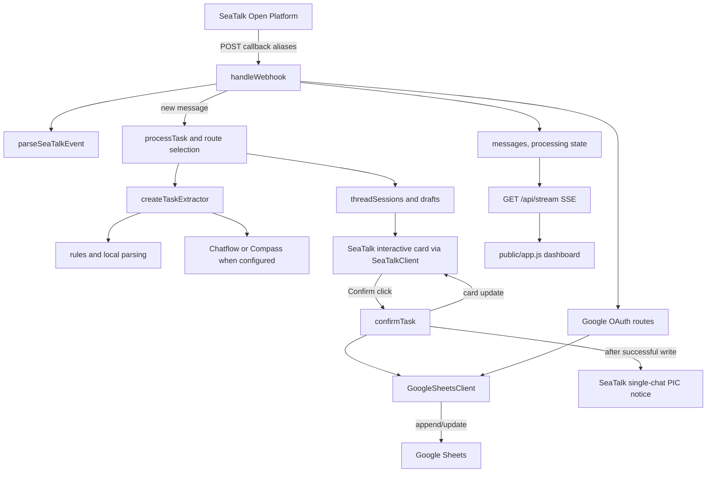

# Architecture

## Component flow

For the message routing and card destination details, see [flows](flows.md) and the
README/source mismatch in [gotchas](gotchas.md).

## Module responsibilities and dependency direction

| Module | Imports | Responsibility |
|---|---|---|
| server.js | All src modules listed below | Owns HTTP routing, wiring, mutable process state, and end-to-end flow |
| src/task-extractor.js | node:fs, node:url | Reads policy files and implements extraction/date logic and optional LLM calls |
| src/google-sheets.js | node:fs, node:path; sheet-task-updates.js | OAuth token persistence, Google Sheets API, row conversion and search |
| src/seatalk.js | No project modules | SeaTalk API client and outbound card/text builders |
| src/thread-sessions.js | No project modules | Pure session/task/clarification model and message-based routing |
| src/confirmation-auth.js | No project modules | Identity normalization and authorization predicates |
| src/confirmation-routing.js | No project modules | Parses callback button values into actions |
| src/sheet-task-updates.js | No project modules | Update intent, status parsing, row mapping and fuzzy matching |

The direction is server.js → independent domain modules. google-sheets.js also imports the
row-conversion/search helpers from sheet-task-updates.js. Modules use Node built-ins and
global fetch; there is no runtime package dependency graph.

Google Sheet rows use columns A:I. Column I stores the task creator's lowercase email, which
survives server restarts and participates in written-task edit authorization. Add the `Creator`
header manually in I1 of the live sheet; the application does not write headers. The PIC or
Creator can edit Priority, Deadline, and Status on a written task.

## Process-local state

| State | Key / content | Creation and cleanup | Restart consequence |
|---|---|---|---|
| messages | Array keyed for duplicate search by record.id; id is event_id, parsed messageId, or a local synthetic ID. Records hold parsed data, raw payload, and processing state. | addMessage prepends newest first; capped at 100. DELETE /api/messages empties only this array. | Dashboard history and dedupe records are lost. |
| clients | Set of open SSE response objects | Added by handleStream; removed on request close | Browser reconnects and receives a fresh snapshot. |
| oauthStates | Random state → expiration timestamp | Created for OAuth start; expires after 10 minutes; expired entries are pruned at next start, callback consumes its state | Pending OAuth handshakes fail. Google token file remains on disk. |
| threadSessions | Key is group:<groupId>:thread:<threadId-or-messageId>, single:<employeeCode>, or sender:<senderId>; value holds target, tasks keyed by shortId, and pendingClarifications keyed by clarifyId. | Created on first routed message; no runtime eviction | Drafts, short IDs, routing history, and pending clarification choices disappear. |
| confirmationDrafts | task:confirm:<draftId> → threadKey, shortId, recordId, draftId | Added before sending a confirmation card; replaced/removed on resend, send failure, or successful write; no TTL | Old cards refer to an unknown draft and cannot be confirmed. |
| sheetUpdateDrafts | updateId → Sheet row, fields, PIC/Creator identity, and promise guards | Created for a Sheet-update card; removed after successful confirmation; failures may leave it in memory; no TTL | Existing update cards cannot be confirmed. |
| sheetMessageReferences | SeaTalk message ID → numeric Sheet Task ID | Recorded for sent assignment/update messages; no TTL or size cap | Quoting an old remembered message no longer finds its Sheet task. |

threadSessions and its task maps are not size-limited. The message cap does not cap those maps.
confirmationDrafts, sheetUpdateDrafts, and sheetMessageReferences also have no general size
limit; their entries are removed only on specific flow paths. OAuth credentials are separate:
GoogleSheetsClient persists them to the configured token path.

## Concurrency guards

| Guard | Scope | Race prevented |
|---|---|---|
| task.confirmPromise | One thread task | Two Confirm callbacks writing the same draft concurrently |
| task.fieldUpdatePromise | One thread task | Overlapping priority/deadline card redraws |
| clarification.promise | One pending clarification | Duplicate choice callbacks creating/routing a task twice |
| pending.fieldUpdatePromise | One Sheet-update draft | Overlapping field changes/redraws for its card |
| pending.confirmPromise | One Sheet-update draft | Duplicate update confirmations writing the same row concurrently |
| GoogleSheetsClient.appendQueue | One client instance | Append/update operations interleaving; especially max(ID)+1 read then append |

These guards are local to one Node process. appendQueue does not coordinate multiple server
instances and does not make max(ID)+1 safe across replicas.

## Fire-and-forget processing

handleWebhook sends the HTTP response without awaiting processTask or interaction handlers
(void processTask(...)). API clients therefore receive callback acknowledgment before
extraction, card delivery, or Sheet work finishes. Handled failures are written to the
record's extraction/sheet/confirmation state and broadcast as processing SSE packets; they
are not returned as the webhook response.
